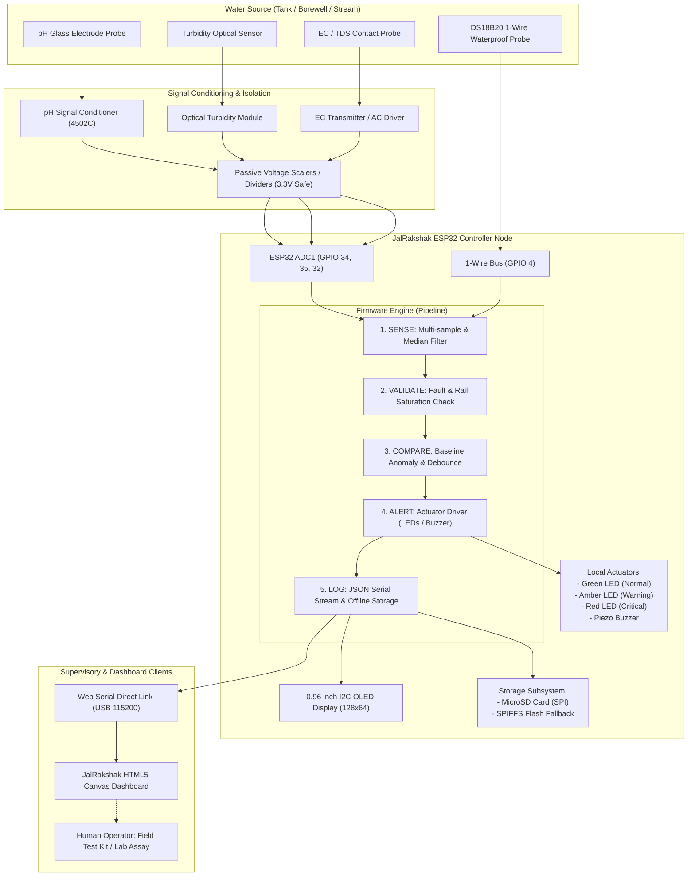
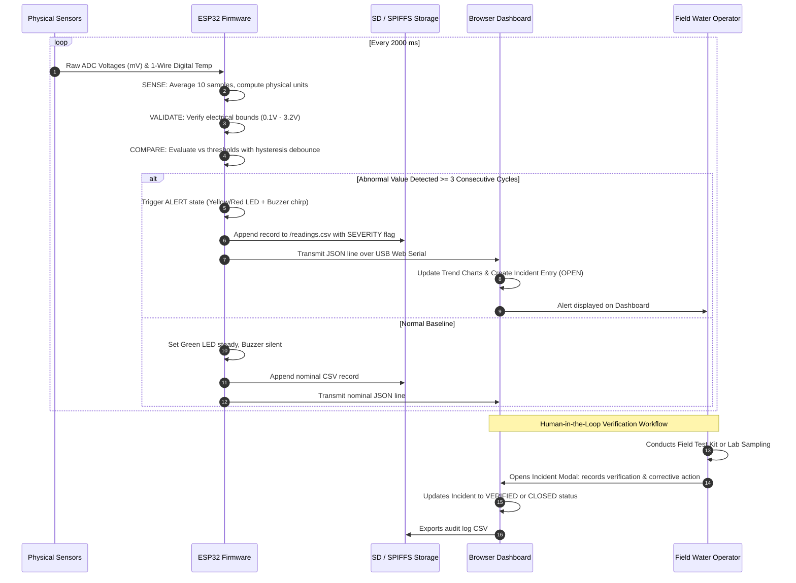
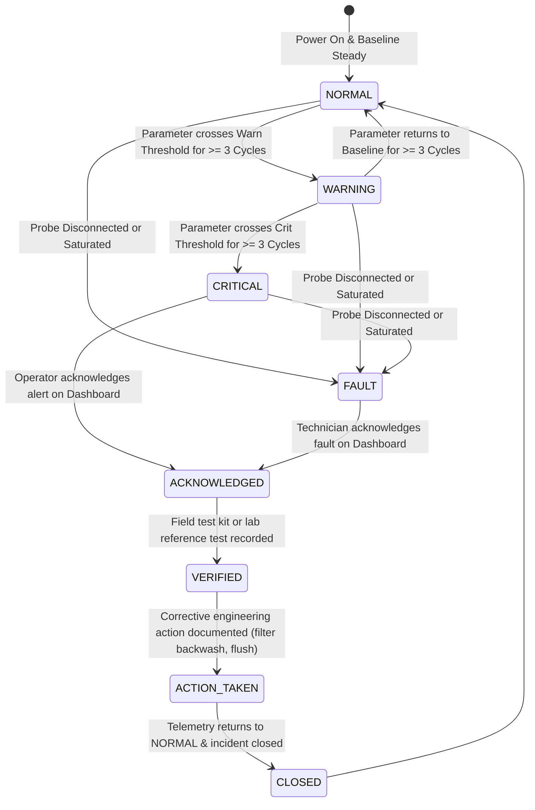

# JalRakshak System Architecture & Technical Design

## 1. Problem Statement & Intended Users

### 1.1 The Challenge
Over 160 million people in India and millions across the Global South depend on community water facilities—including village overhead storage reservoirs (OHTs), public borewells, schools, Anganwadis, and primary health centres. In rural and semi-urban communities, centralized laboratory water quality tests are conducted infrequently (often once every 6 to 12 months). During the intervening periods, pipeline breaks, monsoon silt runoff, industrial effluent breaches, or sewage ingress can go undetected for days, resulting in localized outbreaks of waterborne diseases.

Commercial industrial online analyzers are expensive (₹1,50,000–₹5,00,000+ per station), require constant high-bandwidth internet connectivity, and demand specialized chemical reagents and trained instrumentation engineers.

### 1.2 The JalRakshak Solution
**JalRakshak** is an open-source, affordable (₹5,000–₹10,000 BOM), offline-first water-quality monitoring prototype. Operating on a low-power ESP32 microcontroller, it continuously monitors gross physical and chemical indicators:
- **pH (Acidity / Alkalinity)**
- **Turbidity (Suspended solids & clarity)**
- **Electrical Conductivity (Dissolved ions & salinity)**
- **Water Temperature (Thermal dynamics & compensation baseline)**

By establishing a local baseline and enforcing a **SENSE $\rightarrow$ VALIDATE $\rightarrow$ COMPARE $\rightarrow$ ALERT $\rightarrow$ LOG $\rightarrow$ VERIFY $\rightarrow$ ACT** cycle, JalRakshak detects sudden shifts from normal operating parameters and immediately warns local water operators via audible and visual indicators, retaining offline records even when internet connectivity is completely unavailable.

### 1.3 Intended Users
- **Gram Panchayat Water Operators:** Real-time visibility into overhead tank status before daily pumping.
- **Government Schools & Hostels:** Continuous protection of student drinking-water storage tanks.
- **Community NGOs & Field Technicians:** Rapid deployment during monsoon disease surveillance or flood rehabilitation.
- **Academic & Engineering Students:** Hands-on test bench for IoT, embedded systems, and environmental sensing.

---

## 2. System Architecture Diagram



---

## 3. Data Flow Diagram



---

## 4. Hardware Constraints & Sensor Interface Analysis

| Sensor | Physical Principle | Raw Signal Format | Module Operating Voltage | ESP32 Interfacing Constraint | Mitigation / Circuit |
| :--- | :--- | :--- | :--- | :--- | :--- |
| **pH Sensor** (e.g. pH-4502C) | Potentiometric glass electrode ($mV$) | Analog voltage ($0.0 - 5.0\text{V}$) | $5.0\text{V}$ | ESP32 ADC max input is $3.3\text{V}$. Direct $5\text{V}$ connection destroys the pin! | Scaled via potentiometer onboard or precision $10\text{k}\Omega / 20\text{k}\Omega$ voltage divider. Mapped to **ADC1** (GPIO 34). |
| **Turbidity Sensor** (Optical) | Light scattering ($90^\circ$ nephelometric) | Analog voltage ($0.0 - 4.5\text{V}$) | $5.0\text{V}$ | Non-linear output; voltages drop as turbidity increases. Exceeds $3.3\text{V}$. | Voltage divider to constrain peak clean water voltage to $3.0\text{V}$. Mapped to **ADC1** (GPIO 35). |
| **EC / TDS Sensor** | AC excitation conductivity cell | Analog voltage ($0.0 - 2.3\text{V}$) | $3.3\text{V} - 5.0\text{V}$ | Temperature dependent ($2\%/^\circ\text{C}$). Ground loop leakage with pH probe. | Normalized in firmware to $25^\circ\text{C}$. Probes must be mechanically separated by $\ge 10\text{cm}$ in water tank. Mapped to **ADC1** (GPIO 32). |
| **Temperature** (DS18B20) | Digital Dallas 1-Wire protocol | $9-12$ bit digital serial | $3.0\text{V} - 5.5\text{V}$ | Strict 1-Wire timing; open-drain bus requires pull-up. | Powered at $3.3\text{V}$ with dedicated $4.7\text{k}\Omega$ pull-up resistor on GPIO 4. |

---

## 5. Offline Storage and Recovery Behaviour

1. **Dual Storage Architecture:**
   - **Primary Storage (MicroSD Card):** Formatted in FAT32, connected via hardware VSPI bus (CS: GPIO 5). Records appended sequentially to `/readings.csv`.
   - **Secondary Fallback (Internal SPIFFS / LittleFS Flash):** If the MicroSD card is not present, missing, or encounters write errors, the firmware automatically diverts logging to `/readings_backup.csv` in the internal ESP32 flash memory.
2. **Storage Full Protection (Circular Buffer):**
   - SPIFFS partition is checked prior to write operations. If available flash space falls below $64\text{KB}$, the oldest $20\%$ of records are purged to prevent filesystem corruption.
3. **Deduplication Strategy on Reconnection:**
   - Every logged record is stamped with a monotonic device uptime counter and sample index. When serial or wireless synchronization resumes, receiving software checks `(deviceId, uptimeSec, sampleIndex)` as a composite unique key, discarding duplicates.

---

## 6. Alert & Incident Lifecycle State Machine



---

## 7. Data Format & Schema Definitions

### 7.1 JSON Serial Stream (Telemetry Frame)
Emitted by the ESP32 every sampling interval ($2000\text{ms}$):
```json
{
  "deviceId": "JR-NODE-01",
  "uptime": 128,
  "sample": 64,
  "readings": {
    "ph": 7.24,
    "turbidity": 0.85,
    "ec": 328.0,
    "temperature": 24.50
  },
  "rawVolts": {
    "ph": 1.449,
    "turbidity": 2.910,
    "ec": 0.304
  },
  "health": {
    "ph": "OK",
    "turbidity": "OK",
    "ec": "OK",
    "temperature": "OK"
  },
  "status": {
    "overall": "NORMAL",
    "alerts": "NONE"
  }
}
```

### 7.2 CSV Log Schema
Stored locally on MicroSD and exported from dashboard:
```csv
timestamp,device_id,ph,turbidity_ntu,ec_us_cm,temperature_c,ph_status,turbidity_status,ec_status,temp_status,overall_status,raw_v_ph,raw_v_turb,raw_v_ec,notes
```

---

## 8. Error-Handling Strategy

1. **Open-Circuit & Broken Wire Detection:**
   - Analog inputs floating at $0\text{V}$ ($< 100\text{mV}$) or shorted to $3.3\text{V}$ rail ($> 3.20\text{V}$) are flagged as `HEALTH_DISCONNECTED`.
   - The DS18B20 digital sensor returns $-127.0^\circ\text{C}$ on bus failure or disconnected pull-up; this is trapped and mapped to `HEALTH_DISCONNECTED` instead of being processed as cold water.
2. **Analog Noise Filtering:**
   - Multi-sample averaging: 10 readings collected per ADC channel over $30\text{ms}$, smoothing high-frequency ripple from nearby pump motors or switching power supplies.
3. **Alert Flapping Reduction:**
   - Moving hysteresis counter: Transient spikes caused by air bubbles passing the optical path of the turbidity sensor must persist for 3 successive cycles ($6\text{s}$) before transitioning state.

---

## 9. Security and Privacy Considerations
- **No Cloud Dependency:** Core sensing, alerts, and offline data logging run strictly locally without transmitting water data over public networks.
- **Credential Segregation:** Wi-Fi credentials reside strictly in `config.h`, which is excluded by `.gitignore` to prevent credential leaks into public repositories.
- **Read-Only Telemetry:** The serial and web communication protocols provide read-only telemetry; no remote execution or firmware modification is permitted across unauthenticated local interfaces.

---

## 10. Known Limitations & Roadmap
- **Biological Pathogen Blindness:** Optical and potentiometric sensors cannot detect viruses, cysts, or bacteria (e.g. *E. coli*).
- **Chemical Specificity:** EC measures total ionic conductivity; it cannot distinguish between beneficial calcium ions and toxic heavy metals (arsenic, lead).
- **Future Enhancements (v2.0):**
  - LoRaWAN telemetry for rural telemetry over 10 km.
  - Solar power harvesting with LiFePO4 battery management.
  - Periodic automated ultrasonic probe self-cleaning to mitigate biofouling.
